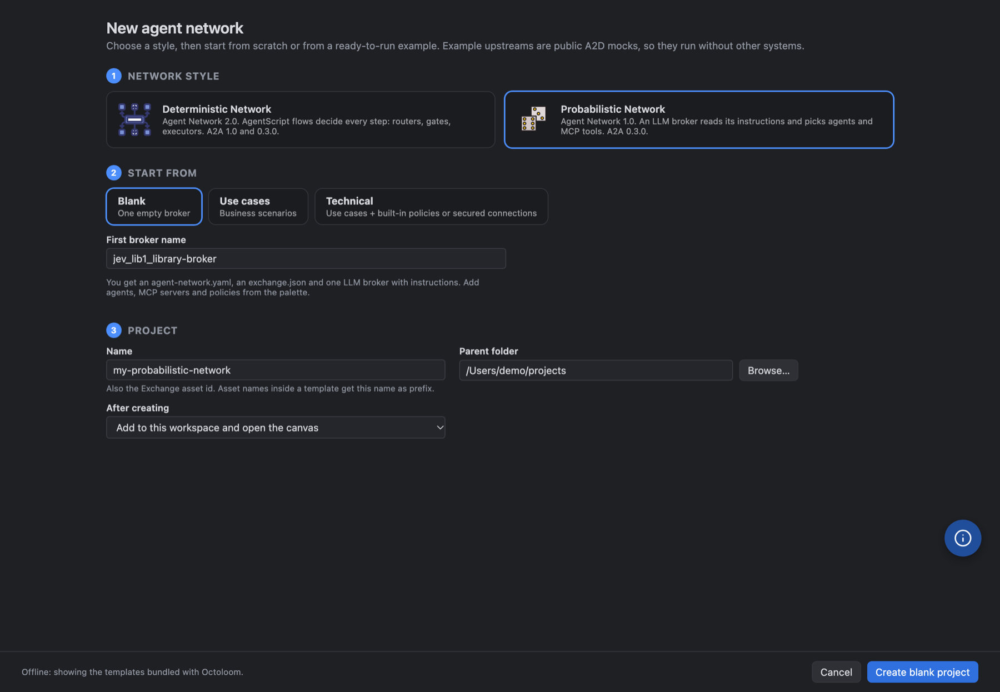
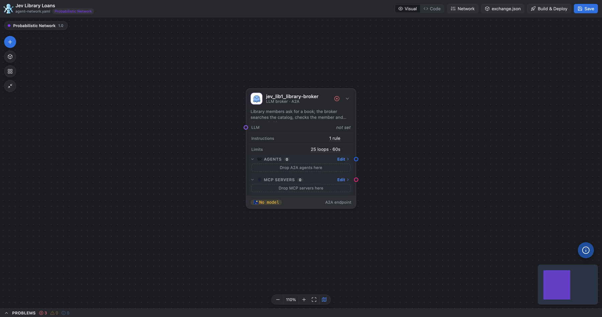
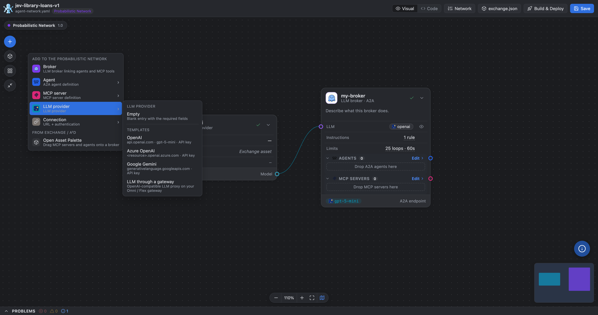
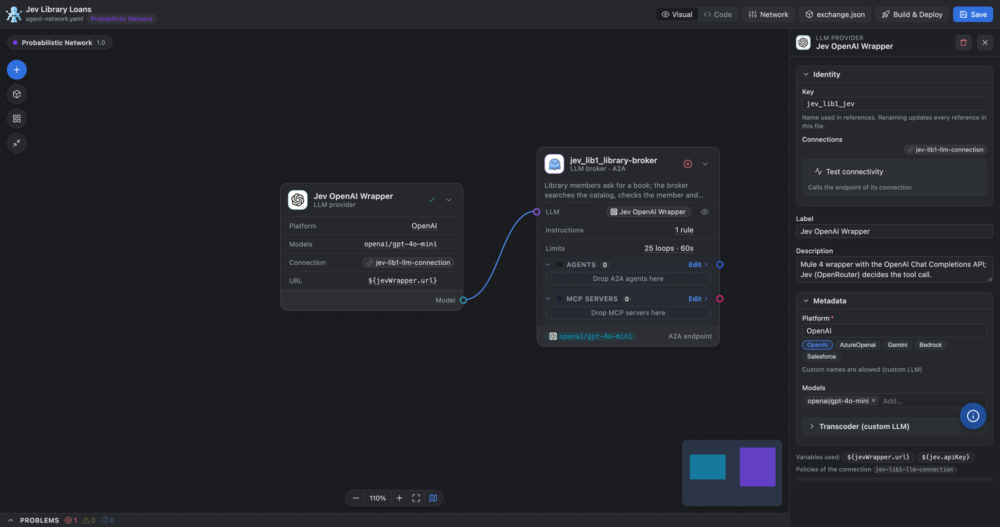
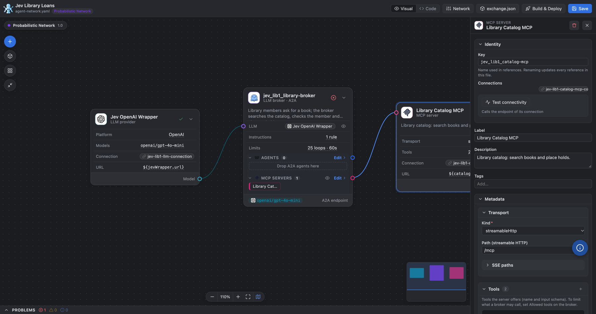
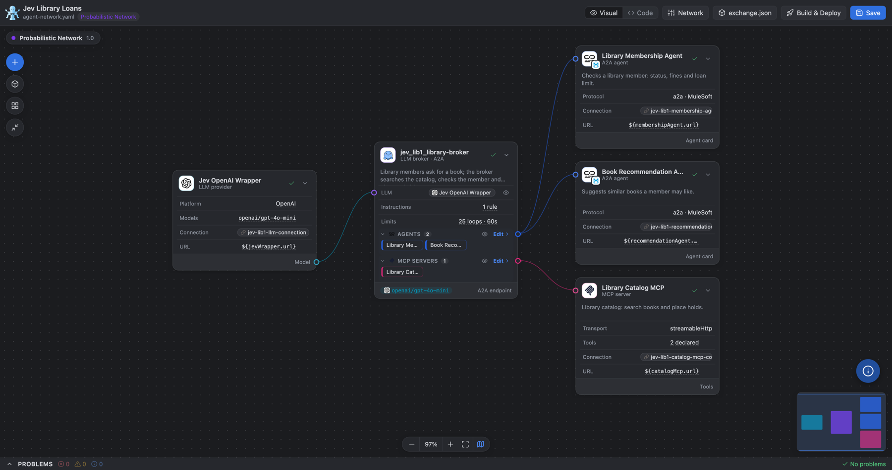
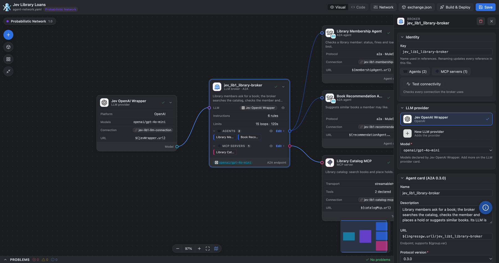
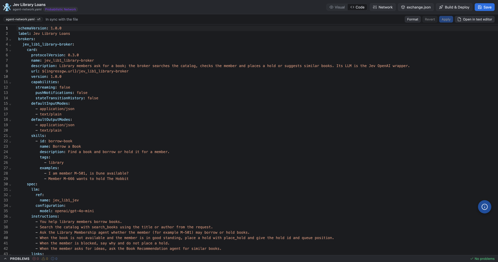
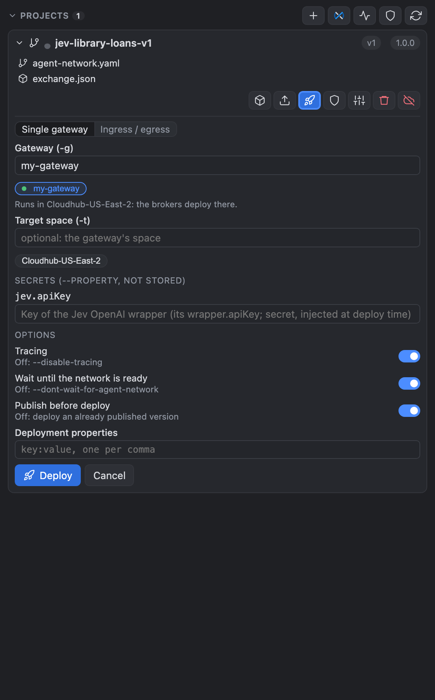
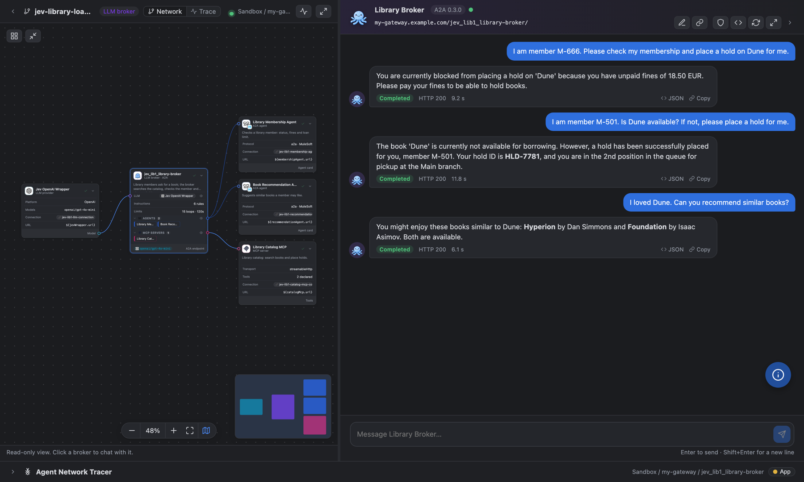

# Chapter 1: Library Loans (Probabilistic Network, v1)

[← Tutorial index](README.md) · [Chapter 2 →](02-v2-restaurant-booking.md)

You build `jev_lib1_library-broker`, an **LLM broker**. A library member asks for a book. The broker searches the catalog, asks the membership agent whether the member may borrow, and places a hold when the book is out. When the member wants ideas, the broker asks the recommendation agent. The broker reads its instructions and lets the LLM pick the next step. Here the LLM is the Jev wrapper: **Jev** picks the step, and `openai/gpt-4o-mini` writes the text and the tool arguments ([why two models](README.md#jev-decides-gpt-4o-mini-writes)).

What you will add:

| Element | Key | Type | Upstream |
| --- | --- | --- | --- |
| LLM provider | `jev_lib1_jev` | OpenAI | Jev wrapper (`${jevWrapper.url}`) |
| MCP server | `jev_lib1_catalog-mcp` | streamable HTTP, tools `search_books`, `place_hold` | [A2D mock](#the-a2d-endpoints) |
| A2A agent | `jev_lib1_membership-agent` | A2A 0.3.0 | [A2D mock](#the-a2d-endpoints) |
| A2A agent | `jev_lib1_recommendation-agent` | A2A 0.3.0 | [A2D mock](#the-a2d-endpoints) |
| Broker | `jev_lib1_library-broker` | LLM broker, A2A 0.3.0 | (served by your gateway) |

The finished project is [`examples/v1-library-loans`](../../examples/v1-library-loans).

## The A2D endpoints

The upstreams are public A2D mocks. They need no key and always return the same test data. You enter them as the defaults of the `exchange.json` variables (Step 1), and the connections point to the variables.

| Variable | Used by | Endpoint |
| --- | --- | --- |
| `catalogMcp.url` | Library Catalog MCP (`search_books`, `place_hold`) | `https://www.a2d-ai.com/api/platform/9b2edd04-bf9a-4b09-8b7f-c31d5802585a/` |
| `membershipAgent.url` | Library Membership Agent (A2A 0.3.0) | `https://www.a2d-ai.com/api/platform/9c75f4b5-449f-4fb3-a0e7-d229cb97cd3c/a2a` |
| `recommendationAgent.url` | Book Recommendation Agent (A2A 0.3.0) | `https://www.a2d-ai.com/api/platform/5e0bb263-9aef-4f38-826e-f7072f2a7764/a2a` |

Keep the trailing `/` on the MCP URL. The broker adds the transport path `/mcp` to it. Each agent's card is at `<agent url>/.well-known/agent-card.json`.

Check them before you build:

```bash
# MCP: list the tools (expect search_books and place_hold)
curl -s https://www.a2d-ai.com/api/platform/9b2edd04-bf9a-4b09-8b7f-c31d5802585a/mcp \
  -H 'content-type: application/json' -H 'accept: application/json, text/event-stream' \
  -d '{"jsonrpc":"2.0","id":"1","method":"tools/list"}'

# Agent card of the membership agent
curl -s https://www.a2d-ai.com/api/platform/9c75f4b5-449f-4fb3-a0e7-d229cb97cd3c/a2a/.well-known/agent-card.json

# Ask the membership agent directly (A2A 0.3.0); expect "M-666 is BLOCKED: unpaid fines of 18.50 EUR"
curl -s https://www.a2d-ai.com/api/platform/9c75f4b5-449f-4fb3-a0e7-d229cb97cd3c/a2a -H 'content-type: application/json' -d '{
  "jsonrpc":"2.0","id":"1","method":"message/send",
  "params":{"message":{"role":"user","messageId":"m1","kind":"message","parts":[{"kind":"text","text":"Check member M-666"}]}}}'
```

Test data in the mocks: book Dune (BK-1001, out), The Hobbit (BK-2002, available), Hyperion (BK-4004) and Foundation (BK-4005). Member M-501 is in good standing. Member M-666 is blocked.

## Step 1: create the project

1. Open the command palette and run **Octoloom: New agent network**. You can also click **+** in the Projects view.
2. Under **1 Network style**, pick **Probabilistic Network** (Agent Network 1.0, A2A 0.3.0).
3. Under **2 Start from**, pick **Blank**. Enter the broker name `jev_lib1_library-broker`.
4. Under **3 Project**, name the project `jev-library-loans-v1` and pick a parent folder.
5. Click **Create blank project**.



Octoloom writes `agent-network.yaml` and `exchange.json`, then opens the canvas with one broker card.



The broker shows a red mark and **No model**, and the Problems bar counts 3 errors. That is expected: the broker has no LLM yet. The errors go away as you add the pieces.

Now open `exchange.json` (the **exchange.json** button in the top bar) and do two things:

- Set `groupId` to **your organization id**.
- Add the variables the network uses, under `metadata.variables` (or copy them from [`examples/v1-library-loans/exchange.json`](../../examples/v1-library-loans/exchange.json)):

| Variable | Secret | Default |
| --- | --- | --- |
| `ingressgw.url` | no | empty (you give your gateway URL at deploy time) |
| `jevWrapper.url` | no | `https://<your-cloudhub-wrapper-deployment-url>/v1/` (a placeholder: replace it or pass your URL at deploy time) |
| `jev.apiKey` | **yes** | empty (you give the key at deploy time) |
| `catalogMcp.url` | no | `https://www.a2d-ai.com/api/platform/9b2edd04-bf9a-4b09-8b7f-c31d5802585a/` |
| `membershipAgent.url` | no | `https://www.a2d-ai.com/api/platform/9c75f4b5-449f-4fb3-a0e7-d229cb97cd3c/a2a` |
| `recommendationAgent.url` | no | `https://www.a2d-ai.com/api/platform/5e0bb263-9aef-4f38-826e-f7072f2a7764/a2a` |

## Step 2: add the Jev wrapper as the LLM provider

Click the blue **+** (**Add to the network**) at the top left of the canvas. The menu lists everything you can add.



1. Pick **LLM provider**.
2. In the inspector on the right, set:
   - **Key**: `jev_lib1_jev`
   - **Label**: `Jev OpenAI Wrapper`
   - **Platform**: `OpenAI` (the wrapper speaks the OpenAI API)
   - **Models**: `openai/gpt-4o-mini`

   > **Why `openai/gpt-4o-mini` and not `~typesafe/jev-latest`?** The model field picks the model that *writes* the text and the tool arguments. Jev (`~typesafe/jev-latest`) *decides* which tool or agent comes next. The wrapper always runs it first, so you never enter it here, and it can't write text. See [Jev decides, gpt-4o-mini writes](README.md#jev-decides-gpt-4o-mini-writes).

3. Add a **connection** for it, `jev-lib1-llm-connection`, with:
   - **URL**: `${jevWrapper.url}` (the wrapper base URL, ending in `/v1/`)
   - **API key**: `${jev.apiKey}` (a variable, so the key is passed only at deploy time)
   - **Timeout**: `600000`
4. Drag from the provider's **Model** port to the broker's **LLM** port, or pick the provider in the broker's LLM field.



The broker's LLM row now shows **Jev OpenAI Wrapper**. In the broker inspector, set the model to `openai/gpt-4o-mini`.

> Never type the real wrapper key into a field. Octoloom writes field values into `agent-network.yaml`. Use `${jev.apiKey}` and give the key at deploy time.

## Step 3: add the Library Catalog MCP server

1. Click **+** and pick **MCP server**.
2. Set:
   - **Key**: `jev_lib1_catalog-mcp`
   - **Label**: `Library Catalog MCP`
   - **Description**: `Library catalog: search books and place holds.`
   - **Transport**: `streamableHttp`, path `/mcp`
3. Under **Tools**, add the two tools with their input schemas:
   - `search_books`: search the catalog by title or author. Input `query` (string, required).
   - `place_hold`: place a hold for a member when the book is out. Inputs `book_id` and `member_id` (strings, required).
4. Add its connection `jev-lib1-catalog-mcp-connection` with URL `${catalogMcp.url}`. It resolves to the A2D mock `https://www.a2d-ai.com/api/platform/9b2edd04-bf9a-4b09-8b7f-c31d5802585a/`.
5. Link it to the broker: drag from the broker's pink **MCP servers** port to the MCP card. In the broker, the allowed tools are `search_books` and `place_hold`.



The tool descriptions matter. Jev reads them to decide which tool fits the request.

## Step 4: add the two A2A agents

Add each agent with **+ → Agent**:

| Field | Membership agent | Recommendation agent |
| --- | --- | --- |
| Key | `jev_lib1_membership-agent` | `jev_lib1_recommendation-agent` |
| Label | `Library Membership Agent` | `Book Recommendation Agent` |
| Description | `Checks a library member: status, fines and loan limit.` | `Suggests similar books a member may like.` |
| Platform / protocol | MuleSoft / a2a | MuleSoft / a2a |
| Card URL | `${membershipAgent.url}` | `${recommendationAgent.url}` |
| Card protocol version | `0.3.0` | `0.3.0` |
| Connection | `jev-lib1-membership-agent-connection` | `jev-lib1-recommendation-agent-connection` |
| A2D endpoint (variable default) | `https://www.a2d-ai.com/api/platform/9c75f4b5-449f-4fb3-a0e7-d229cb97cd3c/a2a` | `https://www.a2d-ai.com/api/platform/5e0bb263-9aef-4f38-826e-f7072f2a7764/a2a` |

Copy the card's skills from the example if you want the same details. Then drag from the broker's blue **Agents** port to each agent card.



The Problems bar now says **No problems**.

## Step 5: write the broker instructions and limits

Click the broker card to open its inspector.



Set the **instructions**, one rule per line:

```
You help library members borrow books.
Search the catalog with search_books using the title or author from the request.
Ask the Library Membership agent whether the member (for example M-501) may borrow or hold books.
When the book is not available and the member is in good standing, place a hold with place_hold and give the hold id and queue position.
When the member is blocked, say why and do not place a hold.
When the member asks for ideas, ask the Book Recommendation agent for similar books.
```

Set the **limits**: 15 loops, 3 consecutive errors, 120 s task timeout.

Check the broker card itself too. Its URL is `${ingressgw.url}/jev_lib1_library-broker`, its protocol version is `0.3.0`, and it has a skill such as "Borrow a Book".

## Step 6: check the YAML

Click **Code** in the top bar. The text is the source of truth: every canvas edit lands here, and edits here show up on the canvas.



Compare it with [`examples/v1-library-loans/agent-network.yaml`](../../examples/v1-library-loans/agent-network.yaml). Click **Save**.

## Step 7: deploy

1. In the **Projects & Deploy** view, click the rocket (**Deploy**) on `jev-library-loans-v1`.
2. Pick **Single gateway** and enter your gateway name. The chip below it shows its state and region.
3. Under **Secrets**, type the wrapper key for `jev.apiKey`. Octoloom passes it with `--property` and does not store it.
4. Under **Deployment properties**, add the values that have no default. The A2D URLs already have their defaults, so you don't need to pass them here:
   - `ingressgw.url:https://<gateway-public-url>`
   - `jevWrapper.url:https://<your-cloudhub-wrapper-deployment-url>/v1/` (your wrapper; the default is only a placeholder)
5. Keep **Tracing**, **Wait until the network is ready** and **Publish before deploy** on. Click **Deploy**.



Octoloom builds and publishes the asset to Exchange, then deploys it. The CLI equivalent is in the [example README](../../examples/v1-library-loans/README.md#deploy).

## Step 8: chat with the broker

When the status light is green, open the chat on the broker. The left side shows the network read-only. The right side is the chat.



Try these prompts:

| Prompt | Jev's calls | Expected result |
| --- | --- | --- |
| I am member M-666. Please check my membership and place a hold on Dune for me. | `search_books`, membership agent | Blocked: unpaid fines of 18.50 EUR. No hold. |
| I am member M-501. Is Dune available? If not, please place a hold for me. | `search_books`, membership agent, `place_hold` | Hold HLD-7781, queue position 2, pickup at the Main branch |
| I loved Dune. Can you recommend similar books? | recommendation agent | Hyperion and Foundation, both available |
| I am member M-501. Is The Hobbit available? Please place a hold if it is not. | `search_books` | Available, so no hold |

Open **Trace** to see each step the broker took. In the wrapper logs, each call shows a line such as `decision {"action":"tool","tool":"search_books","confidence":1}`.

### How the v1 broker offers its agents

A v1 broker sends each linked A2A agent as an OpenAI **custom tool** (free-text input) and its MCP tools as function tools. The wrapper (1.1.0 and later) shows Jev a custom tool as a function with one `input` string, and returns Jev's pick as a `custom_tool_call`. You don't need to change anything in the broker for this.

[Next: Chapter 2, Restaurant Booking →](02-v2-restaurant-booking.md)
