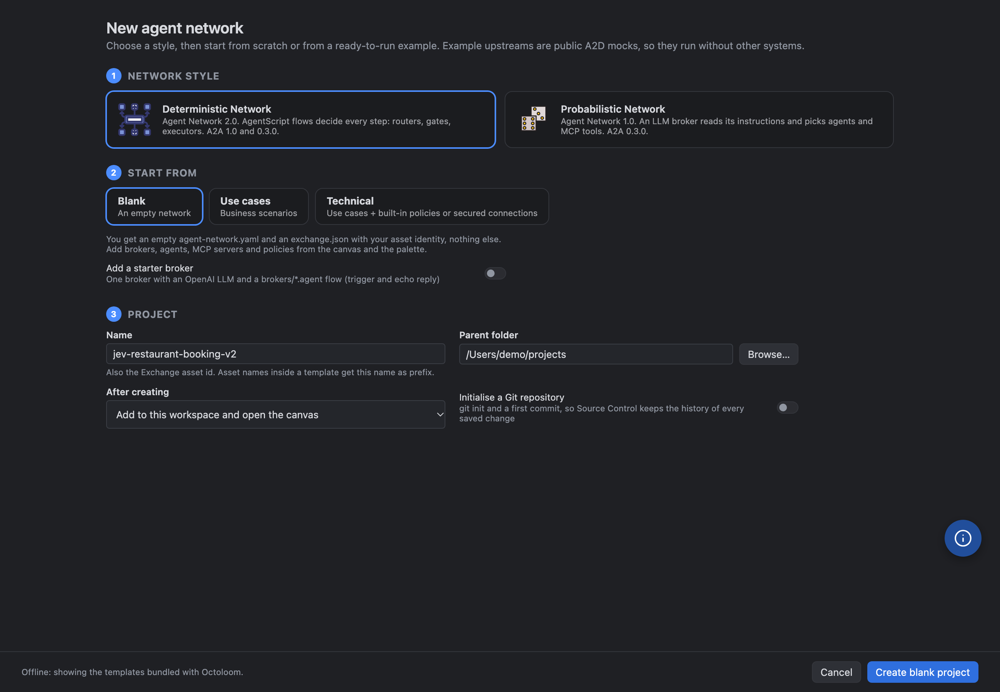
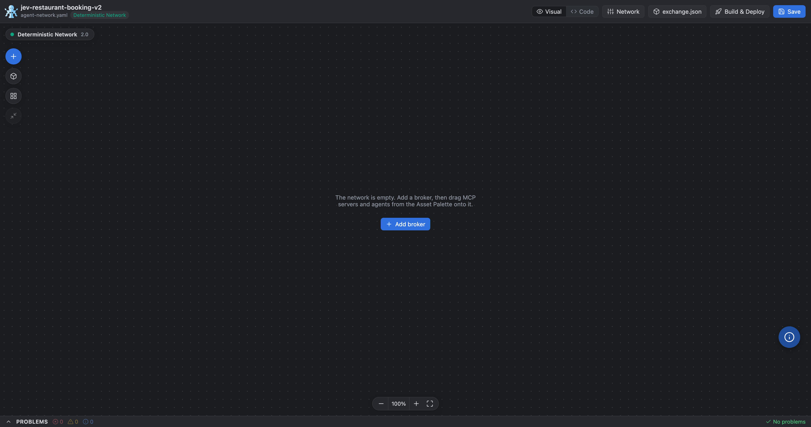
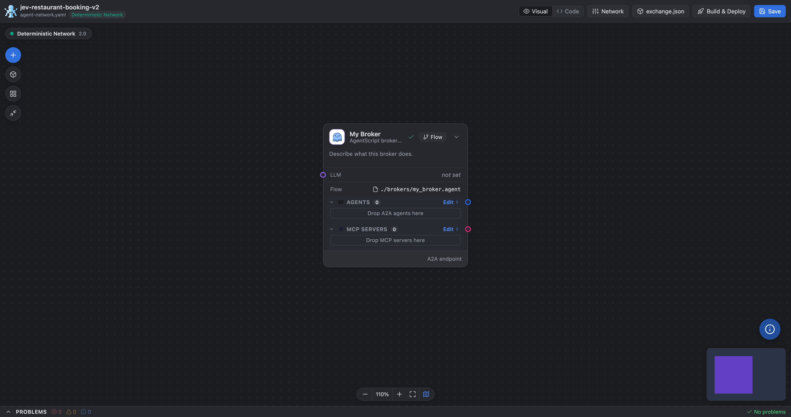
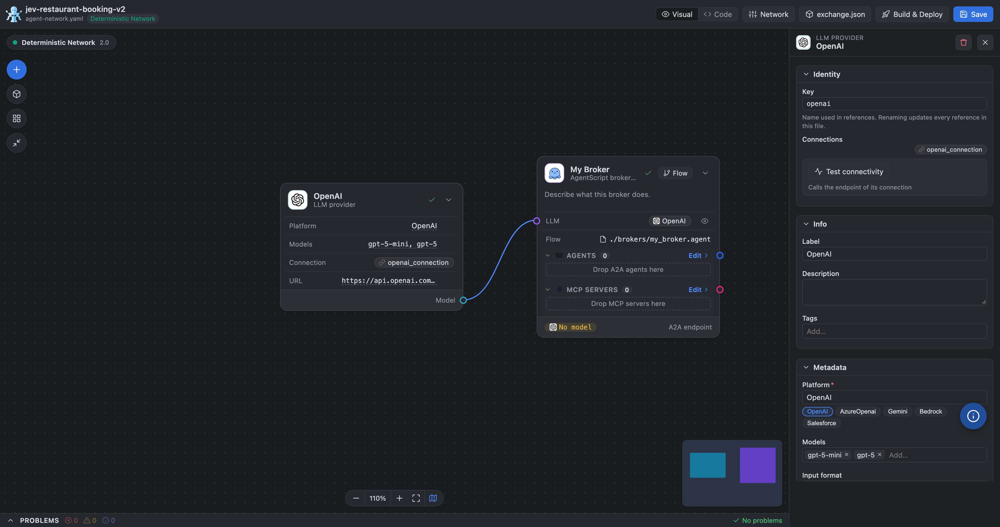
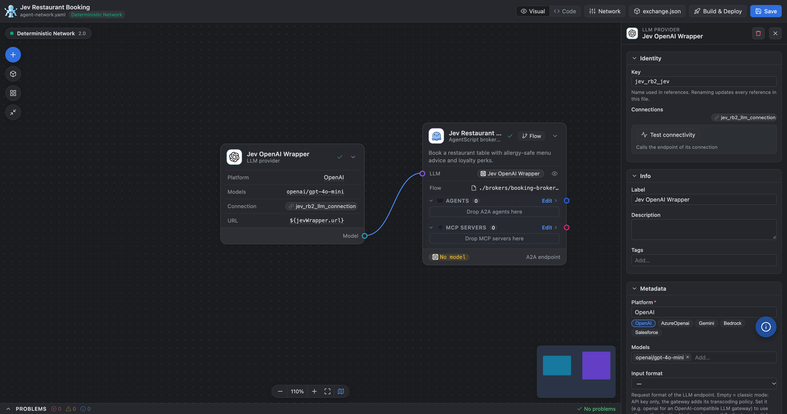
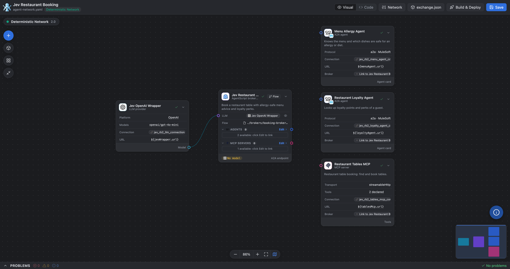
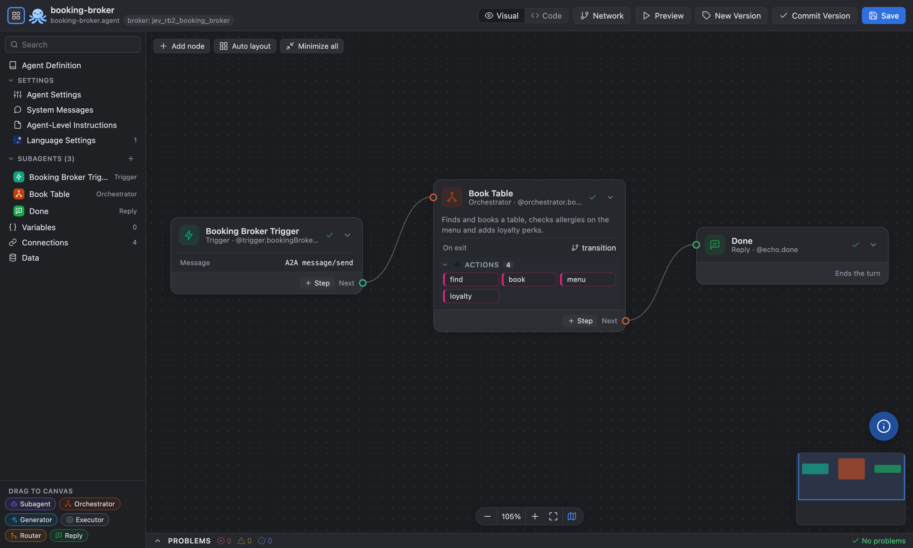
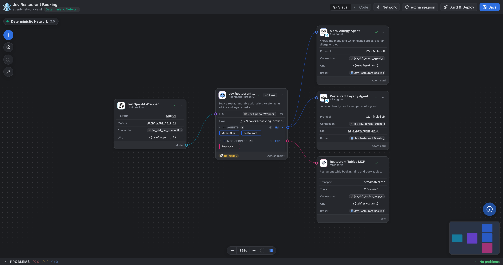
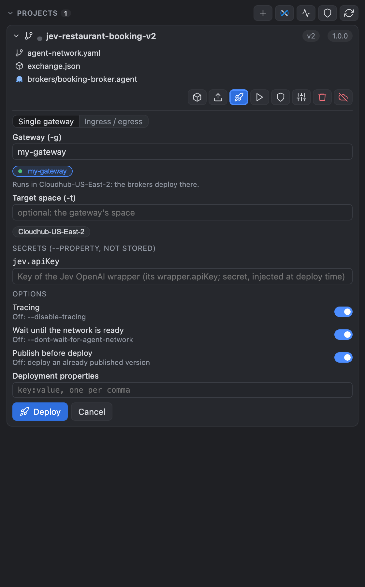
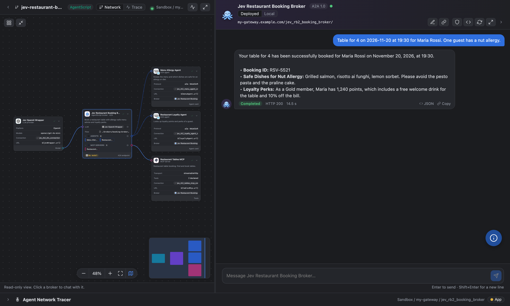

# Chapter 2: Restaurant Booking (Deterministic Network, v2)

[← Chapter 1](01-v1-library-loans.md) · [Tutorial index](README.md)

You build `jev_rb2_booking_broker`, an **AgentScript broker**. A guest asks for a table. The broker finds and books one, asks the menu agent about allergies or diets, and adds the guest's loyalty perks. The network file (`agent-network.yaml`) lists the registry, the connections and the broker. The broker's steps live in an AgentScript flow (`brokers/booking-broker.agent`). One orchestrator step lets the LLM pick among four actions. Through the wrapper, **Jev** picks the action and `openai/gpt-4o-mini` writes the arguments and the reply ([why two models](README.md#jev-decides-gpt-4o-mini-writes)).

What you will add:

| Element | Key | Type | Upstream |
| --- | --- | --- | --- |
| LLM | `jev_rb2_jev` + connection `jev_rb2_llm_connection` | OpenAI | Jev wrapper (`${jevWrapper.url}`), uses `/v1/responses` |
| MCP server | `jev_rb2_tables_mcp` + `jev_rb2_tables_mcp_connection` | streamable HTTP, tools `find_table`, `book_table` | [A2D mock](#the-a2d-endpoints) |
| A2A agent | `jev_rb2_menu_agent` + `jev_rb2_menu_agent_connection` | A2A 1.0 | [A2D mock](#the-a2d-endpoints) |
| A2A agent | `jev_rb2_loyalty_agent` + `jev_rb2_loyalty_agent_connection` | A2A 1.0 | [A2D mock](#the-a2d-endpoints) |
| Broker | `jev_rb2_booking_broker` | AgentScript, A2A 1.0 | (served by your gateway) |

The finished project is [`examples/v2-restaurant-booking`](../../examples/v2-restaurant-booking). The wrapper must be **1.0.1 or later**: v2 brokers call `POST /v1/responses` and check it when they start.

## The A2D endpoints

The upstreams are public A2D mocks. They need no key and always return the same test data.

| Variable | Used by | Endpoint |
| --- | --- | --- |
| `tablesMcp.url` | Restaurant Tables MCP (`find_table`, `book_table`) | `https://www.a2d-ai.com/api/platform/8552e021-0a18-4ca8-979d-729ef0e71273/` |
| `menuAgent.url` | Menu Allergy Agent (A2A 1.0) | `https://www.a2d-ai.com/api/platform/dfb5bd9b-cf76-4847-99bf-00273c063af7/a2a` |
| `loyaltyAgent.url` | Restaurant Loyalty Agent (A2A 1.0) | `https://www.a2d-ai.com/api/platform/2597660f-31fc-4ef7-b08c-91c7c372d2a4/a2a` |

Keep the trailing `/` on the MCP URL. The broker adds the transport path `/mcp` to it. Each agent's card is at `<agent url>/.well-known/agent-card.json`. In `agent-network.yaml`, the agent cards also list the same URL under `supportedInterfaces` (binding `JSONRPC`, protocol version `1.0`).

Check them before you build:

```bash
# MCP: list the tools (expect find_table and book_table)
curl -s https://www.a2d-ai.com/api/platform/8552e021-0a18-4ca8-979d-729ef0e71273/mcp \
  -H 'content-type: application/json' -H 'accept: application/json, text/event-stream' \
  -d '{"jsonrpc":"2.0","id":"1","method":"tools/list"}'

# Agent card of the menu agent
curl -s https://www.a2d-ai.com/api/platform/dfb5bd9b-cf76-4847-99bf-00273c063af7/a2a/.well-known/agent-card.json

# Ask the menu agent directly (A2A 1.0); expect "Nut-free dishes: grilled salmon, risotto ai funghi, lemon sorbet ..."
curl -s https://www.a2d-ai.com/api/platform/dfb5bd9b-cf76-4847-99bf-00273c063af7/a2a -H 'content-type: application/json' -H 'A2A-Version: 1.0' -d '{
  "jsonrpc":"2.0","id":"1","method":"SendMessage",
  "params":{"message":{"role":"ROLE_USER","messageId":"m1","parts":[{"text":"Which dishes are nut-free?"}]}}}'
```

Test data in the mocks: `find_table` returns table T-12 by the window for up to 8 guests, `book_table` returns RSV-5521, and every guest is a Gold loyalty member with 1,240 points.

## Step 1: create the project

1. Run **Octoloom: New agent network**.
2. Under **1 Network style**, pick **Deterministic Network** (Agent Network 2.0, AgentScript flows).
3. Under **2 Start from**, pick **Blank**. Leave **Add a starter broker** off: you add the broker on the canvas in Step 2.
4. Name the project `jev-restaurant-booking-v2` and click **Create blank project**.



You get an empty `agent-network.yaml` (`brokers: {}`) and an `exchange.json`. The canvas says the network is empty and offers **Add broker**.



## Step 2: add the broker and turn its LLM into the Jev wrapper

### 2a. Add the broker

Click **Add broker**. Octoloom adds the AgentScript broker `my_broker` and creates its flow `brokers/my_broker.agent`: a trigger, one `assistant` step and an echo reply. The flow's LLM points to `llm://openai_connection` with the model `gpt-5-mini`.



The broker's LLM row says **not set**, because the network has no `openai_connection` yet.

### 2b. Define the LLM and its connection

Click **+** (**Add to the network**), then **LLM provider → OpenAI**. Octoloom adds the LLM `openai` to the registry and the connection `openai_connection` (`https://api.openai.com/v1`, API key `${openai.apiKey}`). The flow already targets that connection, so the broker card now shows **OpenAI** as its LLM.



### 2c. Point it at the Jev wrapper

With the LLM selected, set:

- **Key**: `jev_rb2_jev`
- **Label**: `Jev OpenAI Wrapper`
- **Platform**: keep `OpenAI`
- **Models**: remove `gpt-5-mini` and `gpt-5`, add `openai/gpt-4o-mini`
- **Input format**: leave it empty

> **Why `openai/gpt-4o-mini` and not `~typesafe/jev-latest`?** The model field picks the model that *writes* the text and the tool arguments. Jev (`~typesafe/jev-latest`) *decides* which tool or agent comes next. The wrapper always runs it first, so you never enter it here, and it can't write text. See [Jev decides, gpt-4o-mini writes](README.md#jev-decides-gpt-4o-mini-writes).

Click the connection chip (`openai_connection`) and set:

- **Key**: `jev_rb2_llm_connection`. Renaming a v2 connection also updates the targets in the broker flows, so `llm://openai_connection` in the `.agent` file becomes `llm://jev_rb2_llm_connection`.
- **URL**: `${jevWrapper.url}`
- **Authentication**: `apiKey`, value `${jev.apiKey}`



Select the broker and set:

- **Key**: `jev_rb2_booking_broker`. Octoloom then asks whether to rename the flow file to match it. Either answer works. The example keeps the shorter `brokers/booking-broker.agent`, so if you want the same files, pick **Keep name** and rename the file in the Explorer later, then update **Flow** on the broker.
- **Card name**: `Jev Restaurant Booking Broker`
- **Description**: `Book a restaurant table with allergy-safe menu advice and loyalty perks.`

The broker footer says **No model** until Step 4. In a v2 network, the flow chooses the model.

### 2d. Fill in exchange.json

In `exchange.json`:

- Check `groupId`. Octoloom fills it with the organization id of your Anypoint login. If it's empty or shows `<enter-your-org-id>`, enter **your organization id**.
- Declare the variables under `metadata.variables` (or copy them from [`examples/v2-restaurant-booking/exchange.json`](../../examples/v2-restaurant-booking/exchange.json)). The Problems bar flags each variable the network uses but doesn't declare (fix: **Add to exchange.json**), and offers **Remove it** for `openai.apiKey`, which the network no longer uses.

| Variable | Secret | Default |
| --- | --- | --- |
| `jevWrapper.url` | no | `https://<your-cloudhub-wrapper-deployment-url>/v1` (a placeholder: replace it or pass your URL at deploy time) |
| `jev.apiKey` | **yes** | empty (you give the key at deploy time) |
| `tablesMcp.url` | no | `https://www.a2d-ai.com/api/platform/8552e021-0a18-4ca8-979d-729ef0e71273/` |
| `menuAgent.url` | no | `https://www.a2d-ai.com/api/platform/dfb5bd9b-cf76-4847-99bf-00273c063af7/a2a` |
| `loyaltyAgent.url` | no | `https://www.a2d-ai.com/api/platform/2597660f-31fc-4ef7-b08c-91c7c372d2a4/a2a` |

## Step 3: add the MCP server and the agents

**+ → MCP server → Empty**:

- **Key** `jev_rb2_tables_mcp`, **label** `Restaurant Tables MCP`, **description** `Restaurant table booking: find and book tables.`
- **Transport**: `streamableHttp`, path `/mcp`, protocol version `2025-06-18`
- **Tools**:
  - `find_table`: find a free table for a party size and time. Inputs `party_size` (number) and `time` (string), both required.
  - `book_table`: book a table that `find_table` returned. Inputs `table_id` and `name` (required) and `time`.
- **Connection** `jev_rb2_tables_mcp_connection`, URL `${tablesMcp.url}` (the A2D mock `https://www.a2d-ai.com/api/platform/8552e021-0a18-4ca8-979d-729ef0e71273/`)

**+ → Agent → Empty**, twice:

| Field | Menu agent | Loyalty agent |
| --- | --- | --- |
| Key | `jev_rb2_menu_agent` | `jev_rb2_loyalty_agent` |
| Label | `Menu Allergy Agent` | `Restaurant Loyalty Agent` |
| Description | `Knows the menu and which dishes are safe for an allergy or diet.` | `Looks up loyalty points and perks of a guest.` |
| Platform | MuleSoft, A2A 1.0 (JSONRPC binding) | MuleSoft, A2A 1.0 (JSONRPC binding) |
| Connection | `jev_rb2_menu_agent_connection`, URL `${menuAgent.url}` | `jev_rb2_loyalty_agent_connection`, URL `${loyaltyAgent.url}` |
| A2D endpoint (variable default) | `https://www.a2d-ai.com/api/platform/dfb5bd9b-cf76-4847-99bf-00273c063af7/a2a` | `https://www.a2d-ai.com/api/platform/2597660f-31fc-4ef7-b08c-91c7c372d2a4/a2a` |
| Card `supportedInterfaces` | same URL, `JSONRPC`, `"1.0"` | same URL, `JSONRPC`, `"1.0"` |



The upstream cards show **Link to Jev Restaurant B...**, and the broker says "2 available: click Edit to link". In a v2 network, the links come from the flow. As soon as the flow uses a connection, the card shows it as linked.

## Step 4: write the AgentScript flow

Click **Flow** on the broker card. You can also open the `.agent` file. The flow canvas opens. It still has the starter steps from **Add broker** (trigger, `assistant`, echo reply) and the model `gpt-5-mini`. You replace them now.



Remove the `assistant` step, then build three nodes:

1. **Trigger** `bookingBrokerTrigger` (kind `a2a`, target `brokers://jev_rb2_booking_broker/a2a`). On a message it moves to the orchestrator.
2. **Orchestrator** `book` (label **Book Table**). Drag **Orchestrator** from *Drag to canvas*, then give it:
   - the system instructions below
   - the four actions `find`, `book`, `menu`, `loyalty`
   - at most 8 loops
   - on exit, a move to the reply
3. **Reply** `done`. It sends the orchestrator's output as a completed A2A 1.0 status update.

Under **Settings → Agent Settings** and **Connections**, declare the LLM and the four actions so they point to the connections from Steps 2 and 3. Set the LLM model to `openai/gpt-4o-mini`. The whole file:

```yaml
# @dialect: AGENTFABRIC=1.0
system:
  instructions: "You are the booking assistant of a restaurant. Be short and friendly."

config:
  agent_name: "booking-broker"
  default_llm: @llm.default

llm:
  default:
    target: "llm://jev_rb2_llm_connection"
    kind: "OpenAI"
    model: "openai/gpt-4o-mini"   # writes the text; Jev decides inside the wrapper

actions:
  menu_agent:
    target: "a2a://jev_rb2_menu_agent_connection"
    kind: "a2a:send_message"
  loyalty_agent:
    target: "a2a://jev_rb2_loyalty_agent_connection"
    kind: "a2a:send_message"
  find_table:
    target: "mcp://jev_rb2_tables_mcp_connection"
    kind: "mcp:tool"
    tool_name: "find_table"
  book_table:
    target: "mcp://jev_rb2_tables_mcp_connection"
    kind: "mcp:tool"
    tool_name: "book_table"

trigger bookingBrokerTrigger:
  kind: "a2a"
  target: "brokers://jev_rb2_booking_broker/a2a"
  on_message: ->
    transition to @orchestrator.book

orchestrator book:
  description: "Finds and books a table, checks allergies on the menu and adds loyalty perks."
  label: "Book Table"
  system:
    instructions: |
      Find a free table with find_table for the party size and time, then book it with book_table using the guest name.
      When the guest mentions an allergy or diet, ask the menu agent which dishes are safe.
      Ask the loyalty agent for the guest's perks.
      Finish with the booking id, the time, safe dishes (if asked) and the perks.
  reasoning:
    instructions: ->
      | {!@request.payload.message.parts[0].text}
    actions:
      find: @actions.find_table
      book: @actions.book_table
      menu: @actions.menu_agent
      loyalty: @actions.loyalty_agent
    max_number_of_loops: 8
  on_exit: ->
    transition to @echo.done

echo done:
  kind: "a2a:status_update_event"
  state: "TASK_STATE_COMPLETED"
  message: a2a.message({messageId: uuid(), parts: [a2a.textPart(@orchestrator.book.output)]})
```

On each loop of the orchestrator, the broker asks the wrapper (`/v1/responses`) for the next step. Jev picks one of the four actions or the final answer, and `gpt-4o-mini` writes the arguments or the text. Keep `model` a chat model: `~typesafe/jev-latest` would fail here, because Jev can only decide ([why](README.md#jev-decides-gpt-4o-mini-writes)).

The Problems bar says **No problems**. Click **Save**.

## Step 5: check the network

Go back to the network (**Network** in the top bar). Every upstream is now linked to the broker through the flow.



Compare `agent-network.yaml` with [the example](../../examples/v2-restaurant-booking/agent-network.yaml) in the **Code** view.

## Step 6: deploy

1. In **Projects & Deploy**, click the rocket on `jev-restaurant-booking-v2`.
2. Enter your gateway name.
3. Type the wrapper key for `jev.apiKey`.
4. Add `jevWrapper.url:https://<your-cloudhub-wrapper-deployment-url>/v1` (your wrapper; the default is only a placeholder) under **Deployment properties**.
5. Click **Deploy**.



The first start of a v2 broker can take several minutes. If you change `exchange.json` after a build, delete `target/` before you deploy again. Connection keys must be unique in an environment: for a second copy, rename the `jev_rb2_` prefix, or the deploy fails with a 409.

## Step 7: chat with the broker

Open the chat on the broker (A2A 1.0).



| Prompt | Expected result |
| --- | --- |
| Table for 4 on 2026-11-20 at 19:30 for Maria Rossi. One guest has a nut allergy. | Table T-12, booking RSV-5521. Nut-free: grilled salmon, risotto ai funghi, lemon sorbet (avoid the pesto pasta and the praline cake). Gold, 1,240 points: a free welcome drink and 10% off |
| Table for 2 on 2026-11-21 at 20:00 for John Smith. We eat gluten-free. | RSV-5521. Gluten-free: grilled salmon, steak frites, panna cotta. Gold perks |
| Book a table for 10 people on 2026-11-22 at 19:00 for Anna Meier. | `find_table` refuses parties over 8. The broker tries another time, then asks you to change the request (`TASK_STATE_INPUT_REQUIRED`). Nothing is booked |

The wrapper logs show Jev's decision for each loop:

```
decision {"action":"tool","tool":"find_table-client__find_table","confidence":1}
decision {"action":"tool","tool":"menu_agent-client","confidence":0.6}
decision {"action":"tool","tool":"book_table-client__book_table","confidence":0.9}
decision {"action":"tool","tool":"loyalty_agent-client","confidence":0.99}
decision {"action":"respond","choice":"respond_to_user","confidence":1}
```

When Jev's confidence is below `jev.minConfidence` (0.5), the wrapper lets the chat model decide alone (`"action":"auto"`).

## What's different from v1

| | v1 Library Loans | v2 Restaurant Booking |
| --- | --- | --- |
| Who decides the steps | The LLM broker, from its instructions | The AgentScript flow. Inside the orchestrator step, the LLM picks the action |
| Links to upstreams | Set on the broker in `agent-network.yaml` | Come from the targets in the `.agent` file |
| Wrapper API | `/v1/chat/completions` | `/v1/responses` |
| A2A | 0.3.0 (`message/send`) | 1.0 (`SendMessage`, header `A2A-Version: 1.0`) |
| Agents offered to the LLM as | OpenAI custom tools | function tools (`<action>-client`) |

[← Tutorial index](README.md)
